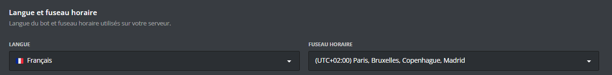
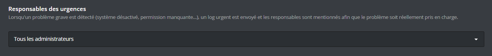

You can access it by [**`clicking here`**](/dashboard/first/settings).

### Language and timezone

This section lets you set the **bot language** as well as the **timezone** used on your server. These settings affect, among other things, how dates and times are displayed in the messages DraftBot sends.

- **Language**: choose the language DraftBot speaks in on your server.
- **Timezone**: select the timezone matching your server so that timestamps stay consistent.

::hint{ type="info" }
  This setting changes the bot's global language for the whole server. It is not a per-member preference.
::

### Emergency contacts

When a serious issue is detected on your server (disabled system, missing permission, etc.), DraftBot sends an **urgent message** in the logs channel and mentions the designated contacts so that the issue actually gets taken care of.

You have two options to choose from:

- **All administrators**: every member holding the Administrator permission on the server is mentioned.
- **Custom list**: you pick the members to be mentioned yourself.

::hint{ type="warning" }
  Take care to configure the emergency contacts: if nobody is designated, critical issues may go unnoticed and disrupt how DraftBot works on your server.
::
