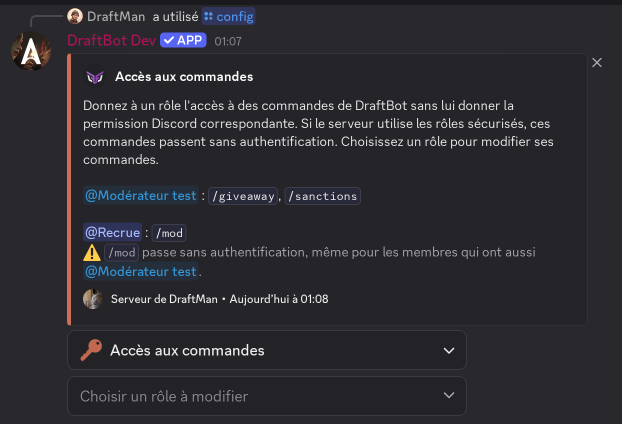
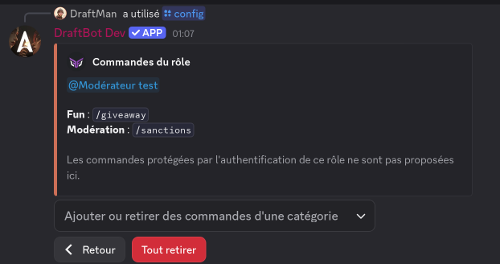

## Le principe

Discord permet de régler qui utilise les commandes d'un bot, et où, dans *Paramètres du serveur > Intégrations > DraftBot*. Cet écran n'existe pas sur l'application mobile. La page [Accès aux commandes](/dashboard/first/command-access) du panel en reprend tous les réglages, et elle fonctionne aussi depuis un téléphone.

Elle sert aussi à confier une commande précise à un rôle sans lui donner la permission Discord qu'elle demande d'habitude. `/sanctions` est par exemple réservée aux administrateurs par défaut : vous pouvez l'autoriser à vos modérateurs sans leur donner la permission *Administrateur*.

## Toutes les commandes, puis chaque commande

En haut de la page, choisissez ce que vous réglez.

- **Toutes les commandes** vaut pour chaque commande de **DraftBot**. C'est ici que vous retirez les commandes à `@everyone`, que vous les autorisez à un rôle, ou que vous les limitez à quelques salons.
- **Une commande** reprend les réglages de Toutes les commandes, puis les précise. Les siens passent en premier.

La recherche trouve aussi les sous-commandes. Les commandes qui ont leurs propres réglages, ou une autorisation à valider, apparaissent en tête de liste.

::hint{ type="info" }
  Autoriser un rôle dans Toutes les commandes ne lui donne jamais une commande qui demande une permission, comme `/ban`. Pour ça, réglez `/ban` lui-même.
::

## Qui peut l'utiliser

Ajoutez des rôles ou des membres, puis choisissez sur chaque ligne **Autoriser**, **Par défaut** ou **Refuser**. La ligne `@everyone` règle tous les membres d'un coup.

Discord applique ces réglages dans cet ordre :

- un membre réglé nommément passe avant ses rôles ;
- un seul rôle autorisé suffit, même si un autre de ses rôles est refusé ;
- `@everyone` ne compte que pour les membres dont aucun rôle n'est réglé.

Pour retirer un réglage, choisissez **Par défaut**. La commande reprend alors le réglage de Toutes les commandes.

Vos changements ne partent sur Discord qu'au clic sur **Sauvegarder**, dans la barre qui apparaît en bas de l'écran. **Réinitialiser** les annule.

## Où

**Tous les salons** ouvre ou ferme la commande partout, avec **Ouvrir** ou **Fermer**. Ajoutez ensuite des salons pour faire des exceptions. Un fil suit les réglages de son salon.

Par exemple, pour que les commandes de **DraftBot** ne marchent que dans `#commandes` : fermez Tous les salons dans Toutes les commandes, puis ouvrez `#commandes`. Pour ouvrir ensuite `/giveaway` dans un nouveau salon `#événements`, ouvrez ce salon sur `/giveaway` seulement.

Ouvrir un salon ne donne accès à personne. Le membre doit aussi y avoir droit dans Qui peut l'utiliser.

## Ce qui est repris de Toutes les commandes

Sur une commande, **Par défaut** indique entre parenthèses ce que donne Toutes les commandes, par exemple *Par défaut (fermé)*. La section *Repris de Toutes les commandes* liste les autres réglages de Toutes les commandes qui comptent pour celle-ci. **Régler dans Toutes les commandes** vous y emmène.

## Ne donner qu'une partie d'une commande

Pour une commande à sous-commandes, vous pouvez n'en donner qu'une partie à un rôle, par exemple `/sanctions lister` sans `/sanctions retirer`. Dans la fenêtre d'ajout, ou ensuite avec le bouton *Toutes les sous-commandes* de la ligne d'un rôle autorisé, décochez les sous-commandes à exclure. Le bouton affiche alors *1 sous-commande sur 2*.

Discord affiche quand même la commande entière au membre, car il ne sait pas filtrer plus finement. C'est **DraftBot** qui refuse les sous-commandes non données, avec un message qui le dit. Les salons et les membres, eux, se règlent toujours sur la commande entière.

## Vérifier un accès

En bas de la page, choisissez un membre, un salon et une commande. La page répond s'il peut la lancer, et pourquoi : par exemple *Refusé : #général est fermé à toutes les commandes*. Si plusieurs réglages le bloquent, elle les cite tous, et un bouton vous emmène à l'endroit où corriger.

## Les commandes non proposées

Certaines commandes ne peuvent pas être autorisées depuis le panel, parce qu'elles modifient la configuration ou les permissions du serveur, ou parce qu'elles effacent des données : \</config>, les sauvegardes, l'attribution de rôles en masse et les réinitialisations. Vous pouvez y régler les salons, mais pas les autoriser à un rôle ou à un membre qui n'a pas la permission.

::hint{ type="warning" }
  Un compte volé qui porte un rôle autorisé pourra lancer ces commandes. Donnez à un rôle ce dont il a vraiment besoin, pas plus.
::

## Sur Discord

Lancez \</config> et choisissez **Accès aux commandes**. Cet écran confie des commandes à un rôle. Choisissez un rôle, puis cochez ses commandes par catégorie. Les salons, les membres et Toutes les commandes se règlent sur le panel.

La première fois, Discord vous demande d'autoriser **DraftBot** à modifier les permissions des commandes en votre nom. C'est une règle de Discord, valable une seule fois par compte.

## Avec les rôles sécurisés

Sur un serveur qui utilise les [rôles sécurisés](/docs/securite/roles-securises), une commande autorisée ici à un rôle ou à un membre passe **sans authentification**. C'est voulu. Le membre reçoit cette commande précise, pas les permissions sécurisées du rôle, qui demandent toujours de s'authentifier.

- Les lignes marquées *Rôle sécurisé* viennent des rôles sécurisés, et leurs membres utilisent la commande après authentification. Elles se modifient dans Rôles sécurisés.
- Une autorisation ajoutée directement dans *Intégrations* sur un rôle sécurisé reste sans effet tant que vous ne l'avez pas validée. La page l'annonce en haut, et la ligne porte **Valider** et **Retirer**. Retirer la supprime de Discord.
- Les autorisations qui existaient avant la sécurisation du rôle sont reprises telles quelles.

Si un membre porte à la fois un rôle sécurisé et un rôle autorisé sur la même commande, l'autorisation l'emporte et il lance la commande sans s'authentifier. La page le signale avec un badge *Sans authentification*.
